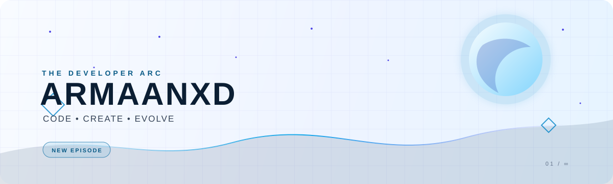
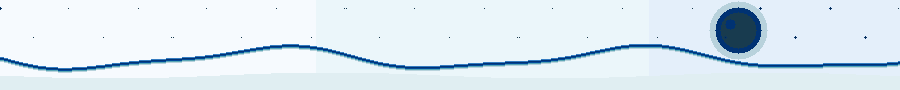

<div align="center">
  <picture>
    <source media="(prefers-color-scheme: dark)" srcset="./assets/hero-blue.svg" />
    
  </picture>
  <picture>
    <source media="(prefers-color-scheme: dark)" srcset="./assets/flow-blue.gif" />
    
  </picture>

  <h1>ARMAANXD</h1>
  <p><strong>Frontend developer · Creative builder · Main-character energy</strong></p>

  <a href="https://github.com/armaanxd?tab=repositories">
    
  </a>
  <a href="https://github.com/armaanxd">
    
  </a>
</div>

<br />

> *“Every line of code is another frame in the story.”*

## ✦ The protagonist

Hey, I’m **Armaan** — a developer who likes turning ideas into clean, expressive digital experiences. I’m currently sharpening my craft, building projects, and documenting the journey one commit at a time.

```text
CURRENT ARC  →  building • learning • shipping
FIGHT STYLE   →  curiosity + consistency
POWER SOURCE  →  late-night ideas and good UI
```

## ⚔ Featured episodes

<table>
  <tr>
    <td width="33%" valign="top">
      <h3>01 · QuestFit</h3>
      <p>A fitness RPG for Android. Real workouts and step goals level up your character, with JD, a 3D companion who warms up as you grow.</p>
      <p><sub>Capacitor · Three.js · Health Connect</sub></p>
      <a href="https://github.com/armaanxd/questfit">View episode →</a> · <a href="https://questfit-evj.pages.dev">Play it</a>
    </td>
    <td width="33%" valign="top">
      <h3>02 · DocuVault</h3>
      <p>Private PDF search with local AI. Upload documents, ask questions and see the sources, all on your own machine.</p>
      <p><sub>Next.js · Ollama · SQLite · Docker</sub></p>
      <a href="https://github.com/armaanxd/docuvault">View episode →</a>
    </td>
    <td width="33%" valign="top">
      <h3>03 · Clinical Trial Matcher</h3>
      <p>Paste a patient summary, get ranked trials from ClinicalTrials.gov with the eligibility reasons explained and a PDF report.</p>
      <p><sub>Python · FastAPI · Docker</sub></p>
      <a href="https://github.com/armaanxd/clinical-trial-matcher">View episode →</a>
    </td>
  </tr>
</table>

## 🛠 Arsenal

<p>
  
  
  
  
  
  
  
  
  
  
  
  
  
  
</p>

## 🐍 The training arc

<picture>
  <source media="(prefers-color-scheme: dark)" srcset="https://raw.githubusercontent.com/armaanxd/armaanxd/output/snake.svg?theme=blue" />
  
</picture>

## 🌙 Current mission

- Building projects that feel as good as they function
- Learning by shipping instead of waiting for perfect
- Turning small ideas into finished, shareable work

## 📡 Find me

<a href="https://github.com/armaanxd">GitHub</a> · <a href="https://www.linkedin.com/">LinkedIn</a> · <a href="mailto:armman3371@gmail.com">Email</a>

<br />

<div align="center">
  <sub>✦ Thanks for stopping by. The next episode is already loading.</sub>
</div>
