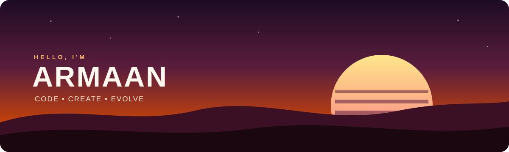

<div align="center">
  

  <p><strong>Frontend developer · Creative builder · Delhi, India</strong></p>

  <a href="https://github.com/armaanxd?tab=repositories">
    
  </a>
  <a href="https://questfit-evj.pages.dev">
    
  </a>

  <p>─────── ◇ ───────</p>
</div>

## ✦ The point of view

> *“Every line of code is another frame in the story.”*

Hey, I’m **Armaan**. I like turning ideas into clean, expressive digital experiences, and I learn by shipping them.

```text
ROLE    →  frontend developer · creative builder
BASED   →  Delhi, India
FOCUS   →  fitness games, local AI, health data
```

**6** public repos · building in public, one commit at a time

## 🎬 In the current cut



## 🎨 Production palette



<p>
  
  
  
  
  
  
  
  
  
  
  
  
  
  
</p>

## 🎞 Featured reel

<table>
  <tr>
    <td width="33%" valign="top">
      <h3>01 · QuestFit</h3>
      <p>A fitness RPG for Android. Real workouts and step goals level up your character, with JD, a 3D companion who warms up as you grow.</p>
      <p><sub>Capacitor · Three.js · Health Connect</sub></p>
      <a href="https://github.com/armaanxd/questfit">View episode →</a> · <a href="https://questfit-evj.pages.dev">Play it</a>
    </td>
    <td width="33%" valign="top">
      <h3>02 · DocuVault</h3>
      <p>Private PDF search with local AI. Upload documents, ask questions and see the sources, all on your own machine.</p>
      <p><sub>Next.js · Ollama · SQLite · Docker</sub></p>
      <a href="https://github.com/armaanxd/docuvault">View episode →</a>
    </td>
    <td width="33%" valign="top">
      <h3>03 · Clinical Trial Matcher</h3>
      <p>Paste a patient summary, get ranked trials from ClinicalTrials.gov with the eligibility reasons explained and a PDF report.</p>
      <p><sub>Python · FastAPI · Docker</sub></p>
      <a href="https://github.com/armaanxd/clinical-trial-matcher">View episode →</a>
    </td>
  </tr>
</table>

## 🐍 Contribution trail

<picture>
  <source media="(prefers-color-scheme: dark)" srcset="https://raw.githubusercontent.com/armaanxd/armaanxd/output/snake.svg?theme=sunset" />
  
</picture>

## ♟ Play the next move



<br />

<div align="center">
  <sub>THE NEXT SCENE</sub>
  <h3>Keep the story moving</h3>
  <a href="https://github.com/armaanxd">GitHub</a> · <a href="https://www.linkedin.com/">LinkedIn</a> · <a href="mailto:armaan3371@gmail.com">Email</a>
  <br /><br />
  <sub>✦ Thanks for stopping by. The next episode is already loading.</sub>
</div>
