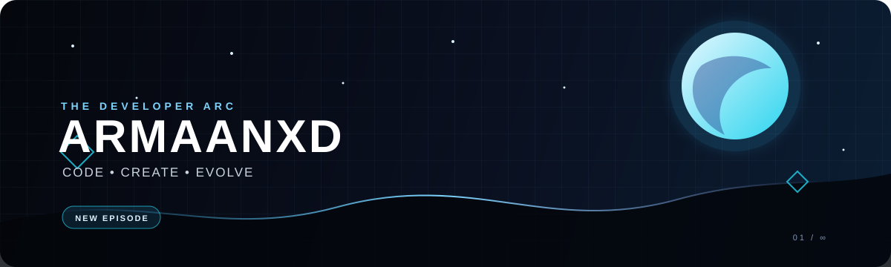

<div align="center">
  

  <h1>ARMAANXD</h1>
  <p><strong>Frontend developer · Creative builder · Main-character energy</strong></p>

  <a href="https://github.com/armaanxd?tab=repositories">
    
  </a>
  <a href="https://github.com/armaanxd">
    
  </a>
</div>

<br />

> *“Every line of code is another frame in the story.”*

## ✦ The protagonist

Hey, I’m **Armaan** — a developer who likes turning ideas into clean, expressive digital experiences. I’m currently sharpening my craft, building projects, and documenting the journey one commit at a time.

```text
CURRENT ARC  →  building • learning • shipping
FIGHT STYLE   →  curiosity + consistency
POWER SOURCE  →  late-night ideas and good UI
```

## ⚔ Featured episodes

Replace these three cards with your real repositories. Keep only projects you would be happy to show first.

<table>
  <tr>
    <td width="33%" valign="top">
      <h3>01 · Your flagship</h3>
      <p>Your strongest project. Explain the problem, not just the technology.</p>
      <a href="https://github.com/armaanxd/REPOSITORY_1">View episode →</a>
    </td>
    <td width="33%" valign="top">
      <h3>02 · Your experiment</h3>
      <p>A creative build, interesting experiment, or project with personality.</p>
      <a href="https://github.com/armaanxd/REPOSITORY_2">View episode →</a>
    </td>
    <td width="33%" valign="top">
      <h3>03 · Your open source</h3>
      <p>A useful tool, contribution, or project that shows how you think.</p>
      <a href="https://github.com/armaanxd/REPOSITORY_3">View episode →</a>
    </td>
  </tr>
</table>

## 🛠 Arsenal

<p>
  
  
  
  
</p>

<!-- Add only technologies you actually use. Example:

-->

## 🌙 Current mission

- Building projects that feel as good as they function
- Learning by shipping instead of waiting for perfect
- Turning small ideas into finished, shareable work

## 📡 Find me

<a href="https://github.com/armaanxd">GitHub</a> · <a href="https://www.linkedin.com/">LinkedIn</a> · <a href="mailto:armman3371@gmail.com">Email</a>

<br />

<div align="center">
  <sub>✦ Thanks for stopping by. The next episode is already loading.</sub>
</div>
